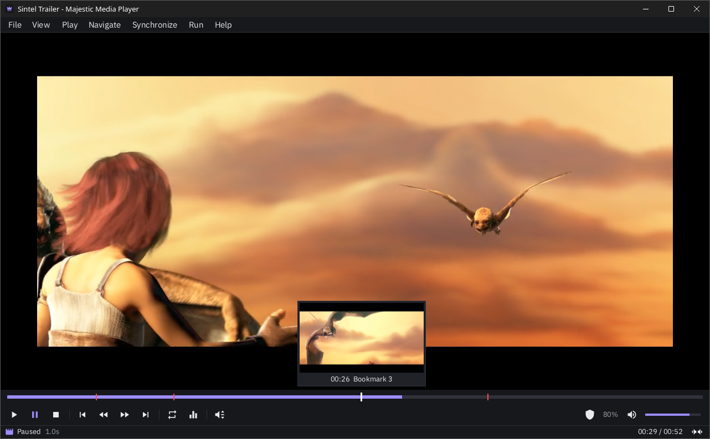

# Majestic Media Player



Inspired by Media Player Classic Home Cinema, built on [libmpv](https://mpv.io) with
[Silky](https://github.com/treeform/silky) UI, vibecoded in Nim.

Majestic's aim is to be the video player I wish I had.

## Features

- **YouTube and other online videos** through yt-dlp, timestamps and playlists included. Pick the stream quality, or save the video to disk.
- **Seek bar previews** of the spot under the cursor, YouTube videos included.
- **Drag & drop or Ctrl+V to open** files and links alike. Ctrl+C copies what's open; Shift+Ctrl+C copies it with the current timestamp.
- **Several playlists, foobar2000-style**, with a playback queue, group headers and Undo/Redo.
- **A media library** (Ctrl+4) of your folders, with a folder tree and a search by words and tags like `artist:name` or `size biggerthan:1GB`.
- **Bookmarks** on the seek bar: snap to them, use them in commands, or embed them as MKV chapters.
- **Commands from bookmarks, chapters and loops.** Cut clips, crop, measure the time between two marks, or run anything else you can type in a terminal.
- **A-B loops, ping-pong, smooth reverse playback and an equalizer.** Turn reverse playback on in the Play button's right-click menu.
- **A command palette** (F3), like Blender's menu search: type part of any command's name and press Enter.
- **Join videos** of any size, frame rate or shape into one from the Run menu, each a chapter named after its file.
- **A very, VERY resizable compact mode.**
- **Zoom, pan and rotate** the video (Ctrl+mouse).
- **VR / 360° videos**, YouTube's included (360°, VR180 and 3D).
- **ReplayGain** from the files' tags, or measured and saved into them.
- **A tag editor**, and tags for files that can't keep their own (MIDI, tracker modules, `.aud`...) in small `.m2c` files in an `m2c` subfolder.
- **Cue sheets**: an album ripped to one file shows up in the playlist as its tracks.
- **File names and tags in any language, emoji included.**
- **An AVS visualizer** for music without a picture, a callback to the Winamp era: a port of Advanced Visualization Studio 2.81d that plays its presets and any `.avs` you add ([links to AVS downloads](AVS.md)).
- **Animated covers** (GIF, APNG and WebP), and quick covers: drop or paste a picture on the video frame while music plays.
- **Seek bar shows what's downloaded** of online videos: parts skipped over are striped.
- **Play/Pause, Previous and Next in the taskbar's window preview**, on Windows and KDE Plasma.
- **Synchronized players**, for footage recorded from several angles.
- **Tracker music** (MOD, S3M, XM, IT, MPTM and dozens more) through libopenmpt, with its patterns scrolling in the video frame as they play.
- **MIDI music** (MID, RMI, KAR, HMI and XMI) through FluidSynth, laid out like tracker patterns as it plays.
- **A shield button** that keeps a player's file: while it's on, files opened from the file manager start a new player instead.
- **Westwood `.aud` game music** (Command & Conquer, Red Alert...).
- **A silent delay after very short audio files**, shown on the seek bar past a `]` mark.

Hold Ctrl, Shift or Alt to see what else you can do, or press F1 for every shortcut. Try right-clicking everything, too!

## Install

### Linux (any distribution): AppImage

Download the `.AppImage` from the [latest release](https://github.com/arkl1te/majestic-media-player/releases/latest), make it executable (right-click → Properties → Allow executing, or `chmod +x`) and run it. It needs nothing installed: it brings everything it uses along. Making it the default player in Options > Formats also adds it to your application launcher, and Help > Check for Updates replaces it with the new release in place.

### Linux from source (CachyOS / Arch)

```sh
git clone https://github.com/arkl1te/majestic-media-player.git
cd majestic-media-player
./install.sh
```

Then search for **Majestic Media Player** in your application launcher, or right-click a video → Open With.

### Windows

Download the `-windows-x64.zip` from the [latest release](https://github.com/arkl1te/majestic-media-player/releases/latest), extract it anywhere and run `majestic-media-player.exe`. Nothing else needs to be installed. Help > Check for Updates installs new releases for you.

### Windows from source

Install [Git for Windows](https://gitforwindows.org), [Nim](https://nim-lang.org) 2.2+ and Visual Studio (or its Build Tools) with the C++ workload. Then, from Git Bash:

```sh
git clone https://github.com/arkl1te/majestic-media-player.git
cd majestic-media-player
./install.sh
```

Majestic shows up in the Start menu.

To update a source install, `git pull` and run `./install.sh` again. `./install.sh --uninstall` removes it.

### If it crashes

Majestic writes what went wrong to `crash.log`, in `~/.config/majestic-media-player/` on Linux and `%APPDATA%\majestic-media-player\` on Windows (the error message says where). Please attach that file when you report the crash. It includes the path of the file that was open.

## More reading

- [TECHNICAL.md](TECHNICAL.md): install options, building by hand, how the player works inside, the source layout and debugging tips.
- [AVS.md](AVS.md): where to get the AVS preset packs I rated highest, for the visualizer.
- [CLAUDE.md](CLAUDE.md): the original brief Majestic was built from (menus, layout and behavior).

## Credits

The AVS visualizer is ported from the source of Advanced Visualization Studio 2.81d that Nullsoft released under a BSD license in 2005 ([visbot/vis_avs](https://github.com/visbot/vis_avs)), with some third-party effects following [grandchild's fork](https://github.com/grandchild/vis_avs) and the Convolution Filter by [Tom Holden](https://github.com/tholden/AVSConvolutionFilter). Their licenses are in [assets/licenses/AVS-Nullsoft-BSD.txt](assets/licenses/AVS-Nullsoft-BSD.txt). Majestic isn't affiliated with or endorsed by Winamp or Nullsoft.

---

<sub>Screenshot: [Sintel](https://durian.blender.org) trailer, © Blender Foundation, CC BY 3.0.</sub>
