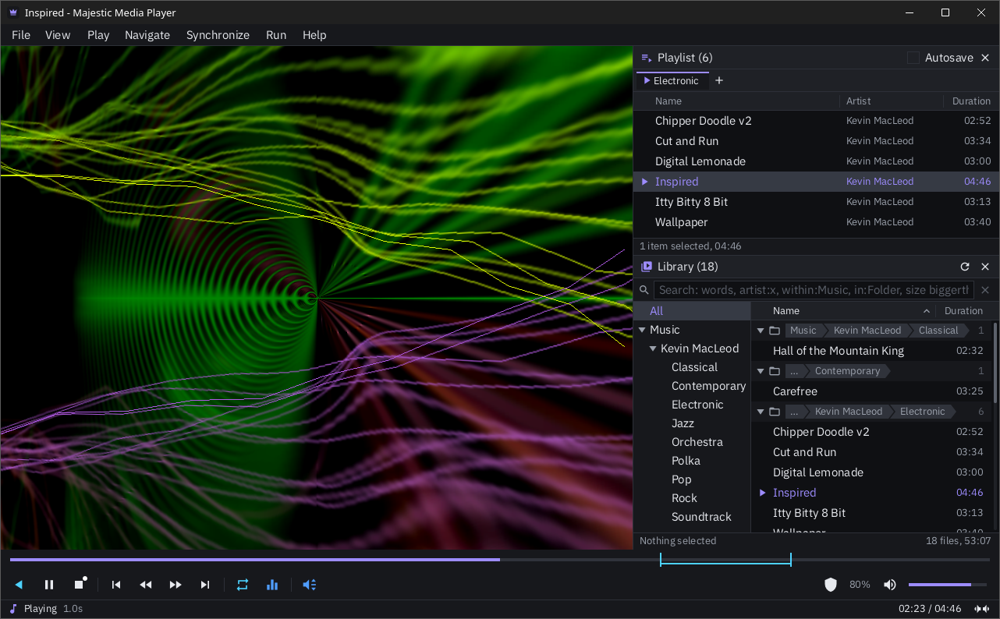

# Majestic Media Player

<a href="screenshot.png"></a> <a href="screenshot-visualizer.png"></a>

Inspired by Media Player Classic Home Cinema, built on [libmpv](https://mpv.io) with
[Silky](https://github.com/treeform/silky) UI, vibecoded in Nim.

Majestic's aim is to be the video player I wish I had.

## Features

- **YouTube and other online videos**: pick the quality, or save them to disk.
- **Seek bar previews.**
- **Drag & drop or Ctrl+V to open** files and links; Ctrl+C copies what's open, Shift+Ctrl+C with the current time.
- **Several playlists**, foobar2000-style, with a playback queue.
- **A media library**, searchable by tags like `artist:name` or `size biggerthan:1GB`.
- **Bookmarks** on the seek bar, savable as MKV chapters.
- **Cut clips, crop, measure time, or anything else via commands**, using bookmarks, chapters and loops.
- **A-B loops, ping-pong, reverse playback and an equalizer.**
- **A command palette** (F3): type what you wish to do and press Enter.
- **A very, VERY resizable compact mode.**
- **Zoom, pan and rotate** (Ctrl+mouse).
- **VR / 360° videos** (360°, VR180 and 3D).
- **ReplayGain**, measured and saved for files without it.
- **A tag editor.**
- **Cue sheets.**
- **File names and tags in any language**, emoji included.
- **An AVS visualizer**, ported from Advanced Visualization Studio 2.81d ([preset downloads](AVS.md)).
- **Animated covers** (GIF, APNG and WebP), and any picture dropped or pasted as a cover.
- **Seek bar shows what's downloaded** of online videos.
- **Taskbar media controls** on Windows and KDE Plasma.
- **Synchronized players**, for multi-angle footage.
- **Tracker music** (MOD, S3M, XM, IT, MPTM and dozens more).
- **MIDI music** (MID, RMI, KAR, HMI and XMI).
- **A shield button** that keeps a player's file: files opened from the file manager start a new player instead.
- **A silent delay after very short audio files.**

<!-- Unreleased (newer than v0.25.0). Once a release with them is tagged, put them in the list above:
- After "A command palette": - **Join videos** of any size, frame rate or shape.
- After "Seek bar previews": - **A waveform seek bar.**
- A-B line: - **A-B loops, ping-pong, smooth reverse playback and an equalizer.**
- Playlists line: - **Several playlists**, foobar2000-style, with a playback queue and group headers.
- Tag editor line: - **A tag editor**, even for files that can't hold tags (MIDI, tracker modules...).
- After "A shield button": - **Westwood `.aud` game music.**
- Taskbar line: - **Taskbar media controls** on Windows and KDE Plasma, media keys and Now Playing on macOS.
-->

Hold Ctrl, Shift or Alt to see what else you can do, or press F1 for every shortcut. Try right-clicking everything, too!

## Install

### Linux (any distribution): AppImage

Download the `.AppImage` from the [latest release](https://github.com/arkl1te/majestic-media-player/releases/latest), make it executable (right-click → Properties → Allow executing, or `chmod +x`) and run it. It needs nothing installed: it brings everything it uses along. Making it the default player in Options > Formats also adds it to your application launcher, and Help > Check for Updates replaces it with the new release in place.

### Linux from source (CachyOS / Arch)

```sh
git clone https://github.com/arkl1te/majestic-media-player.git
cd majestic-media-player
./install.sh
```

Then search for **Majestic Media Player** in your application launcher, or right-click a video → Open With.

### Windows

Download the `-windows-x64.zip` from the [latest release](https://github.com/arkl1te/majestic-media-player/releases/latest), extract it anywhere and run `majestic-media-player.exe`. Nothing else needs to be installed. Help > Check for Updates installs new releases for you.

### Windows from source

Install [Git for Windows](https://gitforwindows.org), [Nim](https://nim-lang.org) 2.2+ and Visual Studio (or its Build Tools) with the C++ workload. Then, from Git Bash:

```sh
git clone https://github.com/arkl1te/majestic-media-player.git
cd majestic-media-player
./install.sh
```

Majestic shows up in the Start menu.

<!-- Unreleased (macOS support, newer than v0.26.1). Once a release with it is tagged, uncomment:
### macOS from source

Install the Xcode command line tools (`xcode-select --install`), [Nim](https://nim-lang.org) 2.2+ and [Homebrew](https://brew.sh). Then:

```sh
git clone https://github.com/arkl1te/majestic-media-player.git
cd majestic-media-player
./install.sh
```

**Majestic Media Player** shows up in `~/Applications` (`./install.sh --system` for `/Applications`). Shortcuts use Cmd where they say Ctrl.
-->

To update a source install, `git pull` and run `./install.sh` again. `./install.sh --uninstall` removes it.

### If it crashes

Majestic writes what went wrong to `crash.log`, in `~/.config/majestic-media-player/` on Linux and `%APPDATA%\majestic-media-player\` on Windows (the error message says where). Please attach that file when you report the crash. It includes the path of the file that was open.

## More reading

- [TECHNICAL.md](TECHNICAL.md): install options, building by hand, how the player works inside, the source layout and debugging tips.
- [AVS.md](AVS.md): where to get the AVS preset packs I rated highest, for the visualizer.
- [CLAUDE.md](CLAUDE.md): the original brief Majestic was built from (menus, layout and behavior).

## Credits

The AVS visualizer is ported from the source of Advanced Visualization Studio 2.81d that Nullsoft released under a BSD license in 2005 ([visbot/vis_avs](https://github.com/visbot/vis_avs)), with some third-party effects following [grandchild's fork](https://github.com/grandchild/vis_avs) and the Convolution Filter by [Tom Holden](https://github.com/tholden/AVSConvolutionFilter). Their licenses are in [assets/licenses/AVS-Nullsoft-BSD.txt](assets/licenses/AVS-Nullsoft-BSD.txt). Majestic isn't affiliated with or endorsed by Winamp or Nullsoft.

---

<sub>Screenshots: [Sintel](https://durian.blender.org) trailer © Blender Foundation, CC BY 3.0. Music by Kevin MacLeod ([incompetech.com](https://incompetech.com)), CC BY 4.0.</sub>
